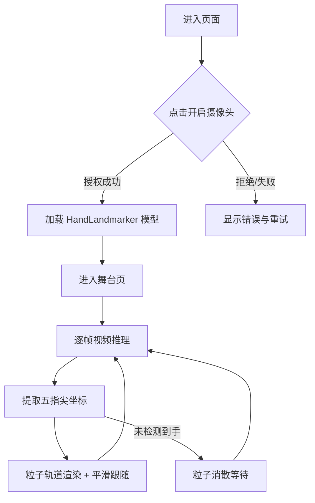

# PRD · 掌心粒子交互页面

## 1. 产品概述
一个基于浏览器摄像头的实时手势交互页面：通过摄像头捕捉用户手掌，精准定位五根手指的指尖，并在屏幕上渲染一组高级粒子特效，让粒子围绕五个指尖做轨道运动，手部移动时粒子流畅跟随。
- 解决的问题：把"手部追踪 + 高级粒子可视化"做成一个单页、零依赖安装、打开即用的沉浸式体验。
- 目标用户：喜欢炫酷视觉特效、手势交互、Web 实验性技术的用户；也可作为演示/作品集展示。
- 价值：展示 Web 端实时 ML 手势识别与高品质粒子渲染结合的上限。

## 2. 核心功能

### 2.1 功能模块
1. **启动页 / 权限引导**：摄像头授权引导、加载状态、一键进入。
2. **实时舞台页（核心）**：摄像头实时画面 + 五指尖粒子轨道特效 + 手势跟随。

### 2.2 页面详情
| 页面名称 | 模块名称 | 功能描述 |
|----------|----------|----------|
| 启动页 | 权限引导 | 说明体验内容，点击"开启摄像头"触发 getUserMedia；处理拒绝/失败；显示模型加载进度 |
| 启动页 | 状态提示 | 摄像头/模型加载中、加载失败、无手部检测等状态的优雅提示 |
| 舞台页 | 视频层 | 镜像翻转的摄像头视频流铺满全屏，作为背景 |
| 舞台页 | 手部骨架层 | 可选的轻量化手部关键点连线/指尖标记，辅助识别"已锁定指尖" |
| 舞台页 | 粒子特效层（核心） | 围绕五指尖的轨道粒子系统，多层级光晕、拖尾、能量环、指尖核心光球 |
| 舞台页 | 控制面板 | 粒子风格切换、强度/数量调节、骨架显隐、重置、全屏等微操 |

## 3. 核心流程
1. 用户进入页面 → 阅读引导 → 点击"开启摄像头" → 浏览器授权。
2. 加载 HandLandmarker 模型 → 成功后进入舞台页。
3. 每帧：视频帧送入模型 → 得到 21 个手部关键点 → 取五个指尖坐标。
4. 粒子系统：每根指尖绑定一组围绕其做轨道运动的粒子 + 核心光球 + 能量环；指尖位置变化时使用平滑插值跟随，避免抖动。
5. 手移出画面或丢失检测时：粒子优雅消散；重新检测到时重新汇聚。

## 4. 用户界面设计

### 4.1 设计风格
- **主题**：暗黑赛博能量风。深邃近黑底色，霓虹青/品红/金的高能量点缀，营造"掌心凝聚能量"的氛围。
- **配色**：主背景 `#05060a`；能量主色 青蓝 `#37e7ff`、品红 `#ff3df0`、金 `#ffd166`；文字高对比近白。
- **字体**：标题使用极具未来感的展示字体（如 Orbitron / Audiowide 一类），正文使用清晰几何无衬线（如 Space Grotesk 替代之外的克制选择），数字/状态使用等宽科技字体。
- **按钮风格**：玻璃拟态 + 霓虹描边发光，hover 时能量流光。
- **布局**：全屏沉浸舞台 + 右上角浮动控制面板 + 左下角状态/HUD。

### 4.2 页面设计概览
| 页面名称 | 模块名称 | UI 元素 |
|----------|----------|--------|
| 启动页 | Hero 引导 | 居中大标题、能量光环动画、主 CTA 按钮、副说明、底部状态条 |
| 舞台页 | 视频背景 | 镜像全屏视频，轻微暗角与色调滤镜增强氛围 |
| 舞台页 | 粒子层 | 指尖核心光球 + 多层轨道粒子 + 拖尾 + 能量环 + 指尖间连接闪弧 |
| 舞台页 | HUD/控制 | 顶部标题、右上玻璃控制面板（滑块/开关）、左下 FPS 与检测状态 |

### 4.3 响应式
- 桌面优先（笔记本/外接摄像头为主场景）。
- 移动端自适应：视频铺满、控制面板折叠为底部抽屉，触控友好。
- 触控优化：按钮与滑块尺寸适配触摸。

### 4.4 视觉特效指引
- 粒子使用加法混合（additive blending）产生发光叠加。
- 每个指尖：1 个脉动核心光球 + 2~3 条不同半径/速度/倾角的轨道环 + 拖尾。
- 指尖间偶发能量闪弧（lightning arc），增强"五指能量场"观感。
- 手部快速移动时粒子产生惯性滞后与拖散，自然又高级。
