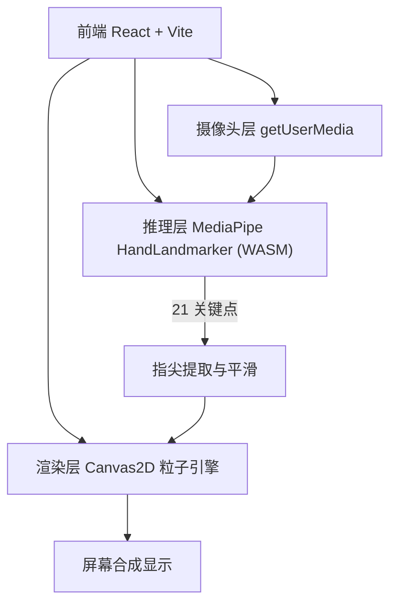

# 技术架构 · 掌心粒子交互页面

## 1. 架构设计
纯前端单页应用，无后端、无数据库。浏览器内完成摄像头采集、手部关键点推理与粒子渲染。

## 2. 技术说明
- 前端：React 18 + TypeScript + Vite
- 样式：Tailwind CSS 3
- 手部追踪：`@mediapipe/tasks-vision` 的 `HandLandmarker`（WASM + GPU 推理，浏览器内运行，无需后端）
- 渲染：自研 Canvas 2D 粒子引擎（加法混合 + 径向光晕 + 拖尾 + 轨道力学），保证视觉高级感与性能
- 初始化工具：`npm create vite@latest`（react-ts 模板）

### 关键技术点
- **镜像处理**：视频与关键点统一做水平镜像，符合"像照镜子"的直觉。
- **指尖平滑**：对 5 个指尖坐标做指数平滑（EMA）+ 速度预测，消除抖动并让粒子有惯性跟随。
- **坐标映射**：归一化关键点坐标 → 屏幕像素坐标，适配不同分辨率与全屏。
- **性能**：推理与渲染共用一个 `requestAnimationFrame` 循环；粒子总数受控；离屏光晕贴图缓存复用。

## 3. 路由定义
单页面应用，仅一个主舞台（无需路由库）。

| 路径 | 用途 |
|------|------|
| `/` | 启动引导 → 舞台体验（状态机内部切换，不引入路由） |

## 4. 状态机（页面内）
| 状态 | 说明 |
|------|------|
| `idle` | 初始引导，等待用户开启摄像头 |
| `loading` | 摄像头/模型加载中 |
| `error` | 授权失败或加载失败，提供重试 |
| `running` | 舞台运行中，实时推理与渲染 |

## 5. 模块划分
- `useCamera`：摄像头流获取与生命周期。
- `useHandTracking`：加载 HandLandmarker，逐帧推理，输出平滑后的指尖坐标。
- `ParticleEngine`：粒子引擎类，管理每指尖的粒子簇、轨道、拖尾、能量环、闪弧。
- `Stage`：合成视频层 + 粒子 Canvas + HUD/控制面板。

## 6. 数据模型
运行时数据（内存对象，无持久化）：
- `Fingertip`：`{ x, y, vx, vy, active, smoothX, smoothY }`
- `Particle`：`{ angle, radius, speed, tilt, size, hue, life, trail[] }`
- 指尖索引：拇指(4)、食指(8)、中指(12)、无名指(16)、小指(20)（MediaPipe 标准）。
